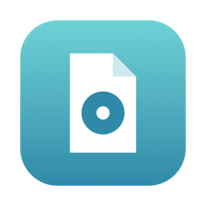
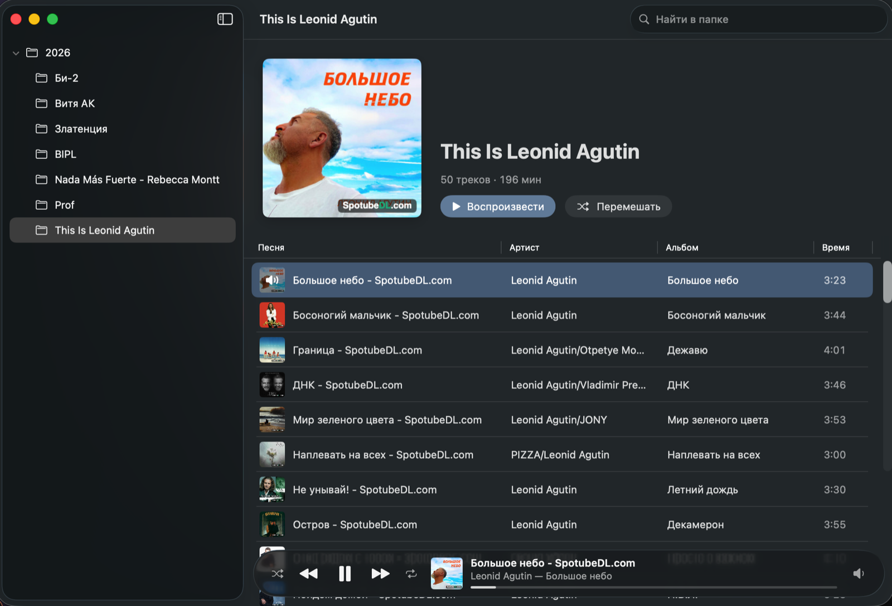

<p align="center">
  
</p>

<h1 align="center">Siply</h1>

<p align="center">
  Лёгкий музыкальный плеер для macOS, который играет прямо из папок.<br>
  Открыл папку — слушаешь. Без импорта и без медиатеки.
</p>

<p align="center">
  <a href="https://github.com/art-ps/siply/releases/latest"><b>Скачать для macOS</b></a> ·
  <a href="https://art-ps.github.io/siply/">Сайт</a> ·
  <a href="README.md">English</a>
</p>

<p align="center">
  
</p>

## Зачем

Музыкальные приложения хотят владеть коллекцией: импортировать, индексировать, синхронизировать. Siply делает наоборот. Ваши папки уже и есть медиатека, Siply показывает их в аккуратном окне в духе Apple Music и играет.

## Возможности

- **Папки вместо медиатеки.** Слева дерево папок, справа треки выбранной папки.
- **Родные форматы.** MP3, AAC/M4A, FLAC, WAV, AIFF, CAF — всё, что играет AVFoundation, включая lossless.
- **Теги и обложки.** Названия, артисты, альбомы и обложки берутся из тегов. Старые ID3 в Windows-1251 показываются кириллицей, а не кракозябрами.
- **Как в Apple Music.** Шапка альбома с кнопками «Воспроизвести» и «Перемешать», таблица треков, плавающая панель плеера с Liquid Glass на macOS 26.
- **Поиск в папке** и колонки, которые запоминают ширину.
- **Клавиатура и медиаклавиши.** Пробел — пауза, Enter — играть выбранный трек; работают Пункт управления и медиаклавиши.
- **Маленький и нативный.** Swift, SwiftUI и AVFoundation, ни одной сторонней зависимости.

## Установка

1. Скачайте `Siply-x.y.z.dmg` в [релизах](https://github.com/art-ps/siply/releases/latest).
2. Откройте образ и перетащите **Siply** в **Программы**.

Нужна macOS 14 Sonoma или новее. Универсальная сборка для Apple Silicon и Intel, подписана и нотаризована Apple.

## Сборка из исходников

```bash
brew install xcodegen
xcodegen generate
xcodebuild -scheme Siply -configuration Release build
```

Тесты: `xcodebuild test -scheme Siply -destination 'platform=macOS'`.
Релиз (подпись, нотаризация, DMG): `scripts/release.sh`.

---

<p align="center">
  Собрано с помощью AI. Карточка проекта на <a href="https://vibecoded.ru/products/siply">vibecoded.ru</a>.
</p>
